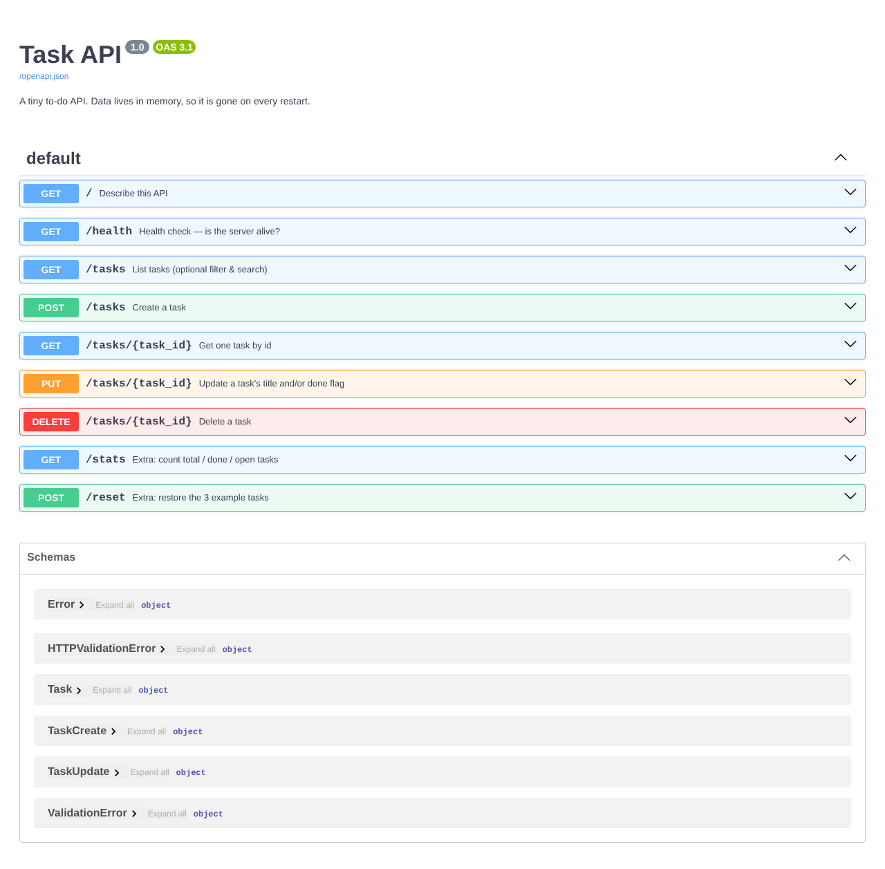

# BE-01 — Build your first CRUD API

A small **Task API** (a to-do list) built with **Python + FastAPI**. It supports the four CRUD operations on tasks
stored **in memory** (a plain Python list, no database yet).

## Run it (one command)

```bash
cd 01-crud-api
pip install -r requirements.txt && uvicorn main:app --reload --port 8000
```

Then open:

- API: <http://localhost:8000>
- Swagger UI (interactive docs): <http://localhost:8000/docs>

## Endpoints

| Method | Path | What it does | Success | Errors |
|---|---|---|---|---|
| GET | `/` | Describes the API | 200 | – |
| GET | `/health` | Health check `{"status":"ok"}` | 200 | – |
| GET | `/tasks` | List all tasks (`?done=true`, `?search=milk` optional) | 200 | – |
| GET | `/tasks/{id}` | Get one task | 200 | 404 |
| POST | `/tasks` | Create a task from `{"title": "..."}` | 201 | 400 |
| PUT | `/tasks/{id}` | Update `title` and/or `done` | 200 | 400, 404 |
| DELETE | `/tasks/{id}` | Delete a task (empty body) | 204 | 404 |
| GET | `/stats` | *(extra)* `{"total","done","open"}` | 200 | – |
| POST | `/reset` | *(extra)* Restore the 3 example tasks | 200 | – |

Every error comes back as JSON, for example `{"error": "Task 99 not found"}`.
FastAPI normally answers invalid bodies with `422`; a custom exception handler turns that into `400`, as the brief asks.

## Example `curl -i` output

```text
$ curl -i http://localhost:8000/tasks/1
HTTP/1.1 200 OK
date: Tue, 27 Oct 2026 09:15:02 GMT
server: uvicorn
content-length: 50
content-type: application/json

{"id":1,"title":"Read the assignment","done":true}
```

The full CRUD checkpoint, with every status code:

```text
GET    /tasks/1            -> 200 {"id":1,"title":"Read the assignment","done":true}
GET    /tasks/99           -> 404 {"error":"Task 99 not found"}
POST   /tasks {"title":"Buy milk"} -> 201 {"id":4,"title":"Buy milk","done":false}
POST   /tasks {}           -> 400 {"error":"Invalid 'title': Field required"}
POST   /tasks {"title":"  "} -> 400 {"error":"title must not be empty"}
PUT    /tasks/4 {"done":true} -> 200 {"id":4,"title":"Buy milk","done":true}
PUT    /tasks/4 {}         -> 400 {"error":"send at least one of: title, done"}
PUT    /tasks/99           -> 404 {"error":"Task 99 not found"}
DELETE /tasks/4            -> 204 (empty body)
DELETE /tasks/4 (again)    -> 404 {"error":"Task 4 not found"}
```

## Swagger UI



In Swagger, use **Try it out** on `POST /tasks` → `GET /tasks` → `PUT /tasks/{task_id}` → `DELETE /tasks/{task_id}` to run the
full CRUD cycle without curl.

## The mortality experiment

I created a task with `POST /tasks`, restarted the server, and called `GET /tasks` again: only the 3 example tasks came back.
The tasks lived in a Python list in the server's memory, so stopping the process threw them away. That is why the next
assignment moves the data into a database.
