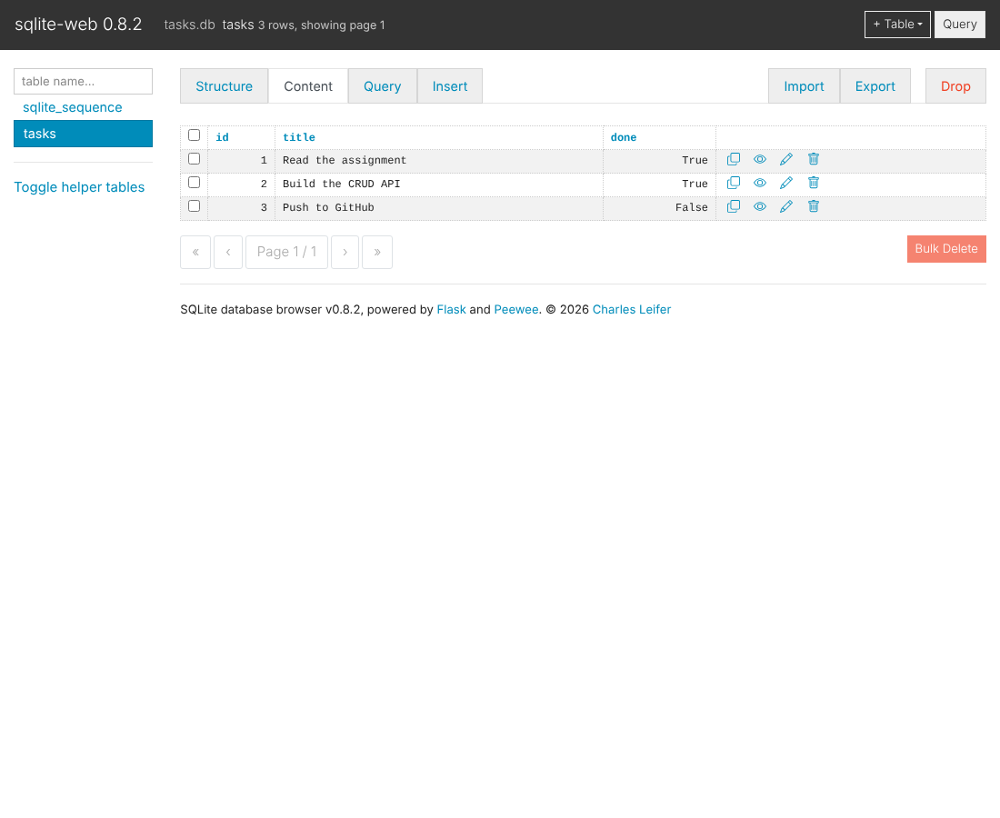

# BE-02 — Connecting your CRUD to the database (SQLite)

The same Task API as [BE-01](../01-crud-api), but tasks now live in a **SQLite** database instead of a Python list.
The endpoints, request bodies and responses did not change. Only the storage layer did, so **data now survives a restart**.

```
BE-01:  Client -> API -> list in memory
BE-02:  Client -> API -> SQLite (tasks.db)
```

## Run it

```bash
cd 02-sqlite-crud
pip install -r requirements.txt && uvicorn main:app --reload --port 8000
```

The first start creates `tasks.db` automatically, creates the `tasks` table if it is missing, and inserts 3 example tasks
**only if the table is empty** (restart as often as you like, you still have 3 example rows, not 6 or 9).

Swagger UI: <http://localhost:8000/docs>

## Why SQLite?

- It is a real SQL database, but it is **one file** on disk. There is no server to install or run.
- It ships with Python (`import sqlite3`), so the project needs no extra dependency for storage.
- It is perfect for a single-user learning project; moving to PostgreSQL later only changes `db.py` (see [BE-04](../03-docker-postgres)).

## Where the database lives

`02-sqlite-crud/tasks.db`, next to the code. It is listed in `.gitignore`: the code is the recipe and the database is
generated on first run.

## How the code is split

| File | Job |
|---|---|
| `main.py` | HTTP layer: routes, validation, status codes. Knows nothing about SQL. |
| `db.py` | Data layer: `init_db()` + `TaskRepository` with `list / get / create / update / delete / stats`. All SQL lives here. |

All queries use `?` placeholders (parameterised SQL), never string formatting, so a title like `'); DROP TABLE tasks;--` is
stored as plain text instead of being executed.

## Endpoints (unchanged from BE-01)

| Method | Path | Success | Errors |
|---|---|---|---|
| GET | `/tasks` (`?done=`, `?search=`, `?sort=title`) | 200 | 400 on bad `sort` |
| GET | `/tasks/{id}` | 200 | 404 |
| POST | `/tasks` | 201 | 400 |
| PUT | `/tasks/{id}` | 200 | 400, 404 |
| DELETE | `/tasks/{id}` | 204 | 404 |
| GET | `/stats` *(extra, uses SQL `COUNT`/`SUM`)* | 200 | – |

## Proof that data survives a restart

```text
POST /tasks {"title":"Buy milk"}  -> 201 {"id":4,"title":"Buy milk","done":false}
(stop the server with Ctrl-C, start it again)
GET  /tasks -> [... {"id":4,"title":"Buy milk","done":false}]   <- still there
```

## Stage 4 — SQL I ran by hand

The queries are in [`sql/explore.sql`](sql/explore.sql). Example run:

```sql
SELECT * FROM tasks WHERE done = 1;
-- [(1, 'Read the assignment', 1)]

UPDATE tasks SET done = 1 WHERE id = 2;
```

Straight after that manual `UPDATE`, `GET /tasks/2` returned `{"id":2,"title":"Build the CRUD API","done":true}`.
The API reads from the database on every request, so it reflected the change immediately without a restart.

### Database viewer



(Viewer: [sqlite-web](https://github.com/coleifer/sqlite-web), run with `pip install sqlite-web && sqlite_web tasks.db`.
DB Browser for SQLite works the same way.)

## Optional extras done

- `GET /tasks?search=milk` uses SQL `LIKE`
- `GET /tasks?done=true` uses a SQL `WHERE`
- `GET /tasks?sort=title` uses `ORDER BY title`
- `GET /stats` counts with SQL `COUNT(*)` / `SUM(done)` instead of Python
