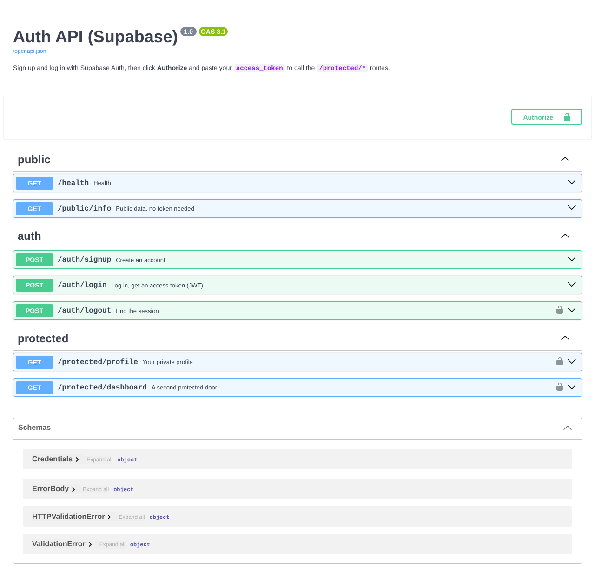

# BE-03 — Auth: Login & protect (Supabase)

A FastAPI service that lets users **sign up, log in and log out through Supabase Auth**, then protects routes with the
**JWT access token** Supabase issues. Password handling and token signing stay with Supabase (the identity provider).
This server only checks tokens.

```
Client ──(email+password)──▶ this API ──▶ Supabase Auth ──▶ JWT access token
Client ──(Authorization: Bearer <JWT>)──▶ this API ──(get_user(token))──▶ Supabase: valid? ──▶ 200 or 401
```

## Set up and run (under 5 minutes)

1. Create a free project at [supabase.com](https://supabase.com) (no card needed).
2. **Project Settings → API**: copy the **Project URL** and the **anon public** key.
3. For quick testing, go to **Authentication → Sign In / Providers → Email** and switch off **Confirm email**.
   Otherwise each new user must click a confirmation email before they can log in.
4. Then:

```bash
cd 04-auth-supabase
cp .env.example .env            # paste SUPABASE_URL and SUPABASE_KEY into .env
pip install -r requirements.txt && uvicorn app.main:app --reload --port 8000
```

You should see `Server running and connected to Supabase (https://<your-ref>.supabase.co)`.

`.env` is in `.gitignore`. **Never commit your keys.** Only `.env.example` (placeholders) is in the repo.

## API reference

| Method | Path | Auth? | Body / header | Success | Errors |
|---|---|---|---|---|---|
| POST | `/auth/signup` | No | `{"email","password"}` | **201** user object | 400 missing field / weak password |
| POST | `/auth/login` | No | `{"email","password"}` | **200** `access_token`, `refresh_token` | 400 missing field, **401** wrong credentials |
| POST | `/auth/logout` | **Yes** | `Authorization: Bearer <token>` | **204** no body | 401 |
| GET | `/protected/profile` | **Yes** | `Authorization: Bearer <token>` | **200** `id`, `email`, `created_at` | **401** missing / bad / expired token |
| GET | `/protected/dashboard` | **Yes** | `Authorization: Bearer <token>` | **200** | 401 |
| GET | `/public/info` | No | – | **200** | – |

Error bodies are always JSON, e.g. `{"error": "Access token required"}` or `{"error": "Invalid or expired token"}`.
If Supabase itself can't be reached the API answers **503**, not 401: an outage on their side does not mean the token is bad.

## Try it with curl

```bash
curl -i -X POST http://localhost:8000/auth/signup -H "Content-Type: application/json" \
     -d '{"email":"test@example.com","password":"password123"}'          # 201

curl -s -X POST http://localhost:8000/auth/login -H "Content-Type: application/json" \
     -d '{"email":"test@example.com","password":"password123"}'          # 200 {"access_token": "eyJ...", ...}

TOKEN=<paste access_token>
curl -i http://localhost:8000/protected/profile -H "Authorization: Bearer $TOKEN"     # 200 + your user
curl -i http://localhost:8000/protected/profile                                       # 401 Access token required
curl -i http://localhost:8000/protected/profile -H "Authorization: Bearer ${TOKEN}x"  # 401 Invalid or expired token
curl -i -X POST http://localhost:8000/auth/logout -H "Authorization: Bearer $TOKEN"   # 204
```

## How the protection works

- [`app/auth.py`](app/auth.py) holds **one** reusable dependency, `current_user`. It reads the header with FastAPI's
  `HTTPBearer`, rejects anything that isn't `Bearer <token>` with 401, then calls `supabase.auth.get_user(token)`. A
  tampered, expired or unknown token makes Supabase raise `AuthApiError`, which becomes `401 Invalid or expired token`.
- Every protected route just declares `user: CurrentUser`. FastAPI runs the dependency **before** the route body, so the
  route code only ever sees a verified user. This is FastAPI's version of Express middleware. Adding
  `/protected/dashboard` took 3 lines.
- **A fresh Supabase client per request.** The SDK stores the logged-in session inside the client object. One shared
  client on a multi-user server could mix up users' sessions, so `new_client()` builds a new, session-less client each time.
- **Logout** calls Supabase's `POST /logout` with the user's own JWT (`auth.admin.sign_out(token)`), which revokes the
  session. Because this API verifies every token with a round trip to Supabase (`get_user`), Supabase answers
  "session not found" for that token from then on, and our guard returns 401. A service that only checked the JWT's
  signature locally would keep accepting a copied token until it expired (1 hour by default). That's the trade-off between
  local JWT verification (fast, no network call) and asking the identity provider (slower, but logout takes effect at once).

## Swagger UI

Open <http://localhost:8000/docs>, log in with `POST /auth/login`, copy the `access_token`, click **Authorize** (the padlock),
paste it, and use **Try it out** on `/protected/profile`. The padlock appears only on the protected routes.



## Tests (no Supabase account needed)

```bash
pytest -q
# 15 passed
```

[`tests/test_auth.py`](tests/test_auth.py) swaps the Supabase client for a small fake that raises the same errors as the real
SDK, then checks every checkpoint: 201 signup, 400 missing fields, 200 login with tokens, 401 wrong password, 401 for a
missing / non-Bearer / empty / tampered token, 200 profile with a valid token, the second protected route, 204 logout and the
token being rejected afterwards, 503 when the provider is down, and the bearer scheme in the OpenAPI spec.
