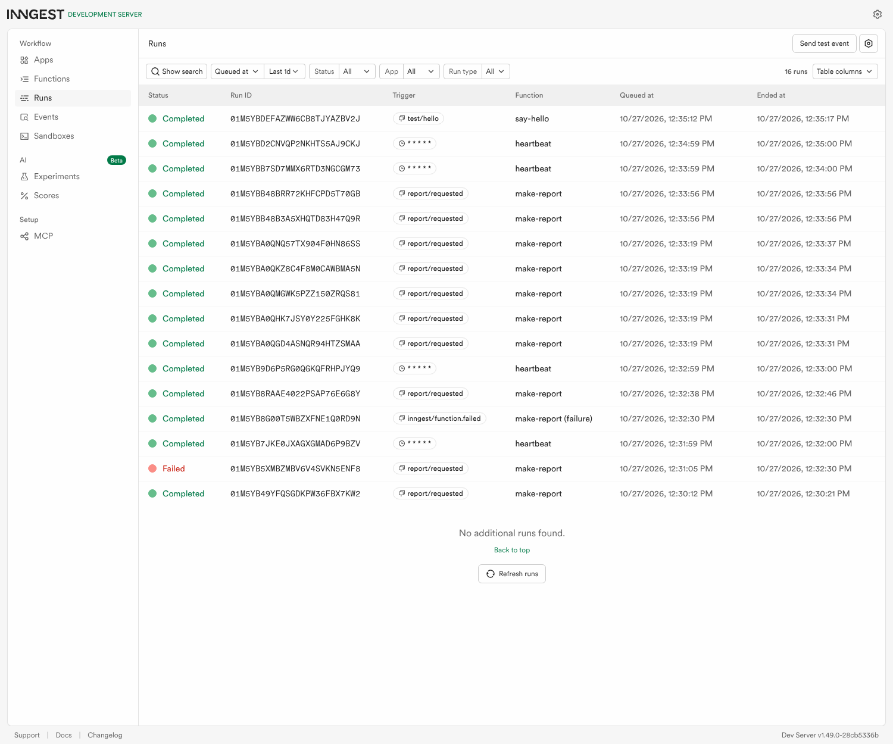
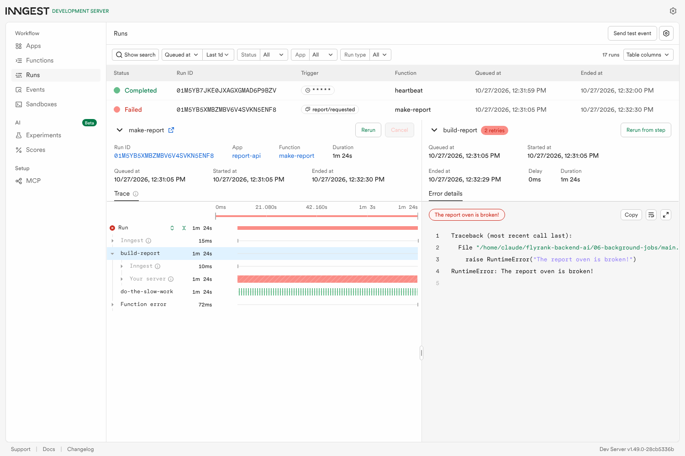

# BE-06 — Your first background job (FastAPI + Inngest)

A small Report API whose slow work happens **in a background job**. `POST /reports` answers **instantly with 202**,
an Inngest function does the ~8-second work, and `GET /reports/{id}` tells the client when it's done. A **cron job**
runs every minute with no request at all.

Pattern: **accept fast → work in the background → report status.**

## Run it (two terminals)

```bash
cd 06-background-jobs
pip install -r requirements.txt

# terminal 1: the API (INNGEST_DEV=1 = talk to the local Dev Server, no account or keys)
INNGEST_DEV=1 uvicorn main:app --reload --port 8000

# terminal 2: the Inngest Dev Server + dashboard at http://localhost:8288
npx inngest-cli@latest dev -u http://localhost:8000/api/inngest
```

(Windows PowerShell: `$env:INNGEST_DEV=1; uvicorn main:app --reload --port 8000`)

## Endpoints and functions

| Kind | Name | Trigger | What it does |
|---|---|---|---|
| Endpoint | `GET /health` | request | `{"status":"ok"}` |
| Endpoint | `POST /reports` | request | validates `{"topic": ...}`, saves `pending`, sends event `report/requested`, returns **202** `{id, status}` in milliseconds. Missing topic → **400**, no event sent. |
| Endpoint | `GET /reports/{id}` | request | `pending` → `done` + result (or `failed` + error). Unknown id → **404**. |
| Endpoint | `GET /reports` | request | *(extra)* all reports: the control panel |
| Function | `say-hello` | event `test/hello` | sleeps 5 s, returns `"Hello from the background!"` |
| Function | `make-report` | event `report/requested` | step `do-the-slow-work` (sleep 8 s) → step `build-report` (builds and saves the result). `retries=2`, max 2 at once. |
| Function | `make-report (failure)` | when `make-report` fails for good | marks the report `failed` so it doesn't stay `pending` forever |
| Function | `heartbeat` | cron `* * * * *` | logs one summary line: how many reports are pending / done / failed |

## Proof: 202 now, result later

```text
POST /reports {"topic":"cats"}  -> 202 in 0.0109 s   {"id":"46525972","status":"pending"}
GET  /reports/46525972 (+2 s)   -> {"id":"46525972","topic":"cats","status":"pending"}
GET  /reports/46525972 (+11 s)  -> {"id":"46525972","topic":"cats","status":"done",
                                    "result":"A very thorough report about cats: 4 letters of pure insight.",
                                    "finished_at":"2026-10-27T09:30:20.982593+00:00"}
```

The request took **11 milliseconds** even though the work takes 8 seconds. The endpoint only records the order and sends
an event; Inngest calls our function to do the work.

## Stage 3: jobs fail, watch the retry

`POST /reports {"topic":"fail"}` makes `build-report` raise `RuntimeError("The report oven is broken!")`. With `retries=2`
the dashboard shows 3 attempts (`build-report` badge: **2 retries**) over about 1m24s of backoff, then **Failed**. The
failure handler sets the report to `{"status":"failed","error":"The report oven is broken!"}`.

**Bad input vs. bad moment:** a missing topic is the client's mistake and will be wrong every time, so it is rejected at the
door with `400` and no job is created. Retries are only for failures that might go away if you wait (a network blip, a busy
service), because retrying a wrong input just fails three times instead of once.

## Stage 4: the clock knocks

`heartbeat` has a cron trigger instead of an event. It ran every minute on its own:

```text
INFO:     heartbeat 2026-10-27T09:34:00+00:00 reports: pending=0 done=5 failed=0
INFO:     heartbeat 2026-10-27T09:35:00+00:00 reports: pending=0 done=5 failed=0
INFO:     heartbeat 2026-10-27T09:36:00+00:00 reports: pending=0 done=5 failed=0
```

- Every day at 08:00 would be **`0 8 * * *`**.
- Every Sunday at 22:00 would be **`0 22 * * 0`**.

(Cron on servers usually runs in UTC; Inngest also accepts a prefix like `TZ=Africa/Cairo 0 8 * * *`.)

## Dashboard

All three functions: completed `make-report` runs, the **Failed** run with its failure handler, `say-hello`, and the
`heartbeat` cron runs one minute apart:



The failed run: the `build-report` step with **2 retries** and the error:



## Stretch goals done

**Idempotency.** I sent the same `report/requested` event (same id) twice more after the report was already built. The
function checks the saved status first (and again right before writing), so `builds` stayed at **1**. Jobs must survive running
twice because at-least-once delivery means a duplicate event, a retry after a timeout, or a replay *will* happen eventually,
and a non-idempotent job would then email twice, charge twice, or build twice.

**Concurrency limit (2).** I enqueued 5 reports at once. They finished in waves of two: `09:33:31 ×2`, `09:33:34 ×2`,
`09:33:37 ×1`. Note: Inngest does not count a *sleeping* step towards the limit, only steps that are executing, so
`build-report` does 3 s of real work to make the limit visible. You'd want a queue to be slow on purpose when the thing
behind it can't take more: a rate-limited AI API, a small database, or a partner's fragile endpoint.

**Durability (the restart experiment).** I started a report, killed the API (`Ctrl-C`) during the 8-second sleep, and
started it again 8 seconds later. Inngest's call to the dead server failed, so it retried after a short backoff; the
retry skipped the already-finished sleep step and ran `build-report`, and the report came back `done` with `builds: 1`. The
job survived because Inngest stored its progress, not my server. My **in-memory** `reports` dict did *not* survive (the
record was missing until the job re-created it), which is the next reason to use a database.
