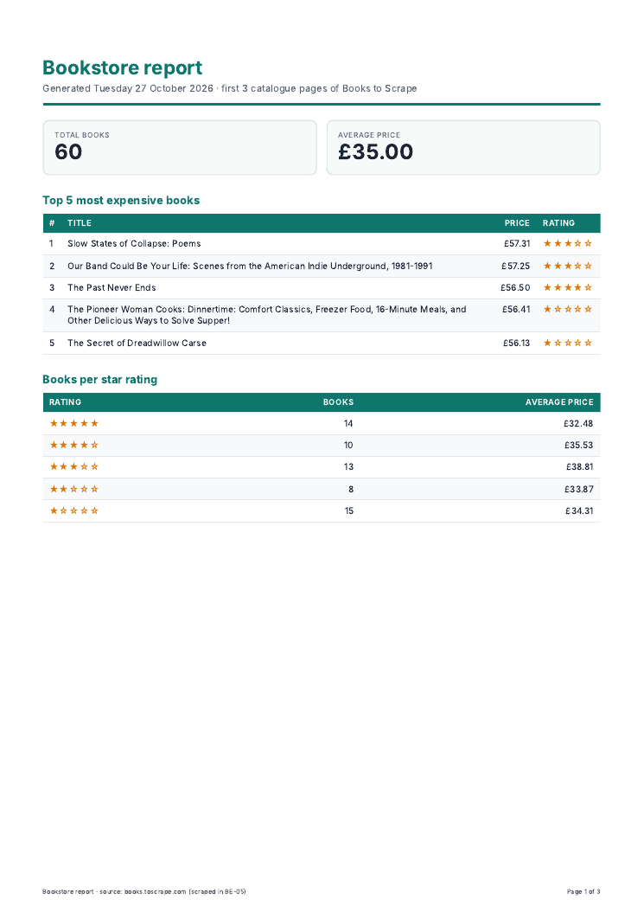
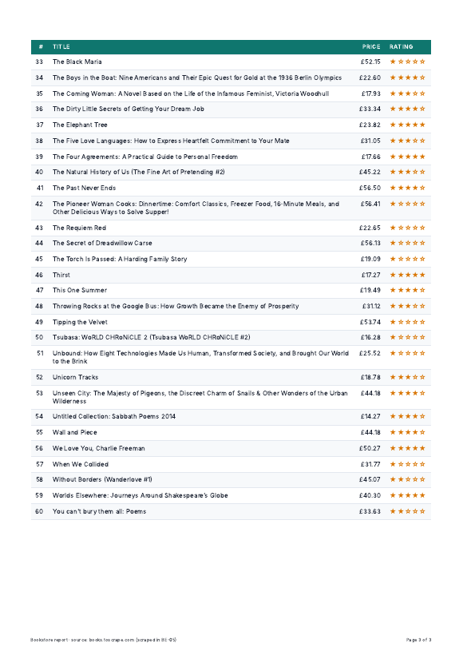

# A8 — PDF report generator

Query the data with SQL, render it into a real PDF, and let the API generate the file and hand it out **by link**.

```
Query (SQLite, 4 aggregations) -> Render (HTML template -> headless Chromium -> PDF) -> Store (reports/<id>.pdf + a row) -> Serve (GET /reports/<id>/file)
```

**Dataset: Option B, the bookstore.** The 60 books I scraped from books.toscrape.com in
[BE-05](../05-polite-scraper) (`data/books.json`, a copy of that assignment's `output/books.json`).

## Run it

```bash
cd 07-pdf-report
pip install -r requirements.txt
playwright install chromium        # one-time, downloads headless Chromium (~1 min)

python seed.py                      # creates report.db with 60 books (safe to run twice: still 60)
uvicorn main:app --reload --port 8000
```

Then, in another terminal:

```bash
curl -i -X POST http://localhost:8000/reports                      # 201 {"id":1,...,"file":"/reports/1/file"}
curl -o my-report.pdf http://localhost:8000/reports/1/file         # the real PDF
```

## Endpoints

| Method | Path | What it does | Status |
|---|---|---|---|
| POST | `/reports` | Runs the whole pipeline in the request and returns the id + file link. If a report was already made **today**, returns that one instead. Body `{"force": true}` makes a fresh one anyway. | **201** new · **200** existing |
| GET | `/reports/{id}` | The report record with its file link (JSON, a few bytes) | 200 · 404 |
| GET | `/reports/{id}/file` | Streams the PDF from disk, downloaded as `bookstore-report-<date>-<id>.pdf` | 200 · 404 |
| GET | `/reports` | *(extra)* every generated report with its link | 200 |
| GET | `/health` | `{"status":"ok"}` | 200 |

**Store and link:** JSON responses never carry the file's bytes. Only `/file` moves the 110 KB.

## The aggregation SQL (`report_data.py`)

```sql
-- two totals
SELECT COUNT(*) AS total_books, ROUND(AVG(price), 2) AS average_price FROM books;

-- top 5 most expensive
SELECT title, price, rating
FROM books
ORDER BY price DESC, title
LIMIT 5;

-- grouped breakdown: books per star rating
SELECT rating, COUNT(*) AS books, ROUND(AVG(price), 2) AS average_price
FROM books
GROUP BY rating
ORDER BY rating DESC;
```

`python report_data.py` prints the result: 60 books, average **£35.00**, most expensive *Slow States of Collapse: Poems*
(£57.31), and per rating 5★ 14 · 4★ 10 · 3★ 13 · 2★ 8 · 1★ 15 (sums to 60 ✔).

## Proof: POST → download

```text
$ curl -s -w "\n%{http_code} in %{time_total}s\n" -X POST http://localhost:8000/reports
{"id":1,"created_at":"2026-10-27T09:39:43+00:00","file":"/reports/1/file"}
201 in 0.670827s

$ curl -o my-report.pdf http://localhost:8000/reports/1/file
download: 200 application/pdf 112216 bytes
$ file my-report.pdf
my-report.pdf: PDF document, version 1.4, 3 page(s)
```

**When would I move this out of the request?** On my machine it takes ~0.7 s, which is fine for one person clicking one
button. I would move it to a background job (the A7 pattern: `202` now, poll for `done`) as soon as a report regularly takes
more than ~2 seconds, or as soon as several users can trigger it at once. Each render launches a whole Chromium, and a
request that holds a browser for seconds ties up server memory and leaves the user staring at a spinner.

## Proof: ask twice, get one

```text
POST /reports  -> 201 {"id":1, ...}      <- first click renders
POST /reports  -> 200 {"id":1, ...}      <- second click: same id, no new file

3 truly simultaneous POSTs on an empty database:
  201 {"id":1,...}   200 {"id":1,...}   200 {"id":1,...}      files in reports/: 1.pdf

POST /reports {"force": true} -> 201 {"id":2,...}      files: 1.pdf 2.pdf
```

The check protects against double-clicks, browser retries and impatient users re-submitting: without it every click would
render another PDF and burn CPU for an identical file. A check alone isn't enough when two clicks arrive at the same instant
(both would see "no report yet"), so the check-and-create runs under an `asyncio.Lock`. A real-world example where a missing
check costs money: a "send invoice" button that, double-clicked, emails the customer twice and charges their card twice.

## The PDF

Page 1 (KPIs, top 5, breakdown):



The long "All books" table runs over pages 2–3. The page-break trap is fixed with print CSS:

```css
thead { display: table-header-group; }              /* repeat the header row on every page */
tr    { break-inside: avoid; page-break-inside: avoid; }  /* never slice a row in half */
```

On page 3 the header repeats and row 33 starts whole (row 32 ended page 2). Footer: "Page X of 3".



## Optional extras done

- **Pretty:** brand colour, KPI cards, star ratings, zebra rows, footer with page numbers (`displayHeaderFooter`).
- **Control panel:** `GET /reports`.
- **Nice filenames:** downloads as `bookstore-report-2026-10-27-1.pdf`.

`reports/` and `report.db` are in `.gitignore`. They are products; `seed.py` and the code are the recipe.
