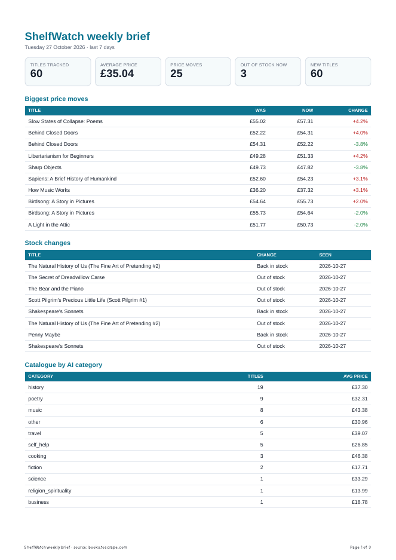
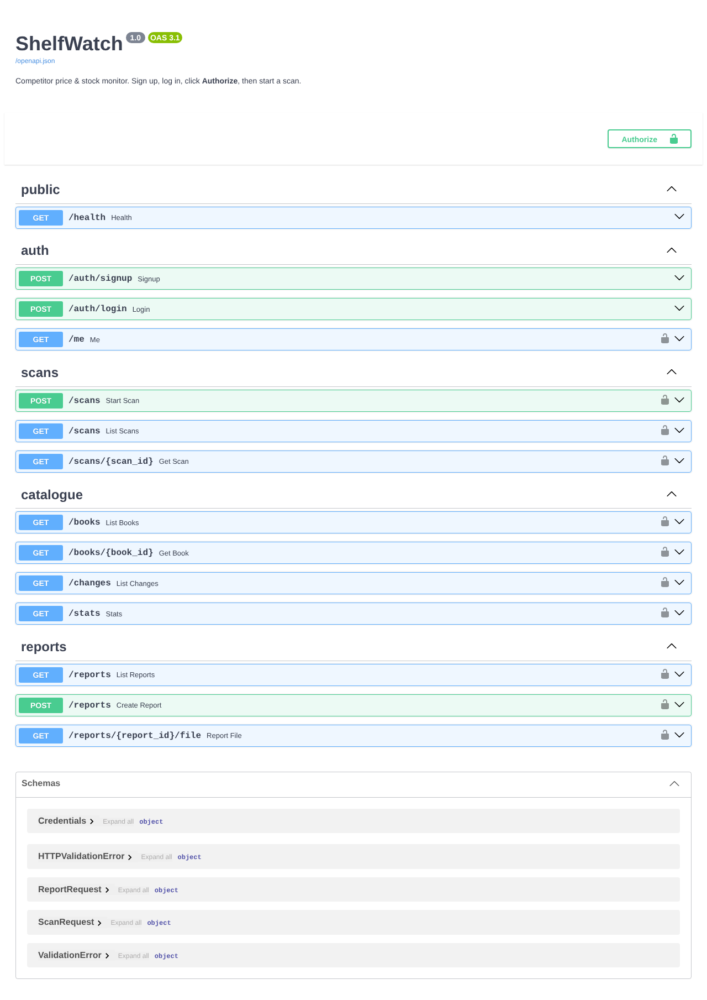

# ShelfWatch: competitor price & stock monitor (FlyRank capstone, "Your 10x Solution")

Small online book resellers check a competitor's prices by hand, title by title. **ShelfWatch** does that check for them
every morning: it politely scans the competitor's catalogue, stores every title's price and stock in a database, records
every change, gives each new title an AI category, and produces a one-page **weekly PDF brief**. Everything sits behind a
login-protected API.

> Overview document: [`My 10x Solution - Asser Almasry.md`](My%2010x%20Solution%20-%20Asser%20Almasry.md) ·
> one-pager: [`docs/one-pager.md`](docs/one-pager.md)

## Run it (two commands)

Python 3.10+.

```bash
cd capstone-shelfwatch
cp .env.example .env            # then set JWT_SECRET to a long random string
pip install -r requirements.txt && playwright install chromium
uvicorn app.main:app --port 8000
```

Open <http://localhost:8000/docs>. It runs with **no API keys**: `LLM_STUB=1` (default) uses offline keyword rules
instead of a model. To use a real model, set `LLM_STUB=0` plus `LLM_BASE_URL` / `LLM_API_KEY` / `LLM_MODEL` (Ollama,
OpenRouter, OpenAI…). Tests: `pytest -q` → **13 passed** (no network, no model, no browser needed).

## 5-minute demo path

The target is the public practice sandbox [books.toscrape.com](https://books.toscrape.com), which exists to be scraped.

1. `POST /auth/signup` `{"email":"owner@myshop.test","password":"a-long-password"}` → **201**
2. `POST /auth/login` (same body) → **200** `access_token`. Click **Authorize** in Swagger and paste it.
3. `POST /scans` `{"pages":3}` → **202** instantly; the scan runs in the background (~1 min, 1 request/second).
4. `GET /scans/1` until `"status":"done"` → 60 titles, 60 new.
5. Run `POST /scans` again. With `DEMO_DRIFT=1` in `.env`, small price/stock moves are simulated, because the sandbox never
   changes. Then `GET /changes` shows `price_up`, `price_down`, `out_of_stock`, `back_in_stock`.
6. `GET /books/{id}`: price history, change log and AI category for one title.
7. `GET /stats`: call it twice and watch the `X-Cache` header go `MISS` → `HIT`.
8. `POST /reports` → **201** + link; click again → **200**, same report. `GET /reports/{id}/file` downloads the PDF.



## Concepts → code

7 of the 7 core concepts, **no swaps**.

| # | Concept | Where | What it does |
|---|---|---|---|
| 1 | **API endpoints** | `app/main.py` | 14 endpoints, Pydantic validation, consistent JSON errors: 400 invalid input, 401, 404, 409 duplicate email, 202 for async work, 201 vs 200 for idempotent creates |
| 2 | **Database** | `app/db.py` | SQLite (`data/shelfwatch.db`): `books`, `snapshots` (price history), `changes`, `scans`, `enrichments`, `reports`, `users`. Created on start, survives restarts, WAL mode so the API reads while a scan writes |
| 3 | **Authentication** | `app/auth.py` | sign up / log in; passwords hashed with **scrypt** + random salt, constant-time compare; **JWT** (HS256, 60 min) checked by one reusable dependency on every route except `/health` and `/auth/*` |
| 4 | **Background + cron jobs** | `app/main.py` (`POST /scans` → `BackgroundTasks`), `app/scans.py`, `app/scheduler.py` | scans answer 202 and run after the response; status is polled at `/scans/{id}`; a second click returns the running scan instead of starting another. **APScheduler** cron: daily scan `0 6 * * *`, weekly report `0 7 * * 1` (configurable, `max_instances=1`, `coalesce`) |
| 5 | **Reporting (PDF)** | `app/reports.py` | SQL aggregation → HTML template → headless Chromium → PDF on disk, served by link (store-and-link); one report per day unless `force` |
| 6 | **Caching** | `app/cache.py`, `app/scraper/fetch.py`, `app/enrich.py` | TTL cache for `/stats` (`X-Cache` header), **invalidated after every scan**; politeness page cache that expires after `PAGE_CACHE_HOURS`; LLM results cached by a hash of prompt version + title + description |
| 7 | **LLM integration** | `app/enrich.py`, `prompts/categorise-v1.md` | one narrow job: categorise a title from a **closed list** of 13. Versioned prompt file, book text only in the user message, `temperature 0`, 30 s timeout, schema validation, **one repair**, then give up (never stores invalid output), one cost-log line per call. Failed titles are retried on the next scan |
| + | (bonus) web scraping | `app/scraper/`, `app/scans.py` | reused from BE-05: honest user-agent, 1 s delay, timeout, status check, "next"-link discovery, one bad page never kills the scan |

## Measured

| | Manual check | ShelfWatch |
|---|---|---|
| 60 competitor titles checked | ~60 min *(estimate: ~1 min per title to open, read price and stock, note it)* | **67 s**, measured: scan 1, 63 pages fetched at 1 request/s, 0 failures |
| Repeat check the same day | another ~60 min | **~1 s**, measured: scan 2, all 63 pages from the page cache, 0 requests to the site |
| Changes found | whatever you notice | every price/stock change recorded, e.g. scan 2: **20 changes** (11 up, 6 down, 2 out of stock, 1 back) |

## API

| Method | Path | Auth | Notes |
|---|---|---|---|
| GET | `/health` | – | liveness |
| POST | `/auth/signup` · `/auth/login` | – | 201 / 200 token |
| GET | `/me` | ✔ | current user |
| POST | `/scans` | ✔ | 202, `{"pages": 1-5}` |
| GET | `/scans` · `/scans/{id}` | ✔ | status, counts, errors |
| GET | `/books` | ✔ | `q`, `category`, `in_stock`, `sort=title\|price\|price_desc\|last_change`, `limit`, `offset` |
| GET | `/books/{id}` | ✔ | + `price_history`, `changes`, `ai` |
| GET | `/changes` | ✔ | `kind`, `include_new`, `limit` |
| GET | `/stats` | ✔ | cached |
| POST / GET | `/reports` | ✔ | 201 new / 200 existing today; `{"force": true}` |
| GET | `/reports/{id}/file` | ✔ | the PDF |



## Safety and honesty notes

- **No secrets in Git:** `.env`, the database, the page cache and generated PDFs are all in `.gitignore` (`data/`).
  The app refuses to start with a missing or placeholder `JWT_SECRET`.
- **Data:** only the public practice sandbox. No personal data except the user's own email and a password hash.
- **`DEMO_DRIFT=1` is a simulation.** The sandbox's prices never change, so for the demo ShelfWatch nudges about 1 in 7
  prices by 1–5% and flips about 1 in 23 stock states, repeatably. Turn it off (`0`) for real monitoring.
- **`LLM_STUB=1` is not AI.** Keyword rules give a rough category so the app runs offline; the stored `model` field says
  `stub-keyword-rules` so stub results are never mistaken for model output.

## Future ideas (not in scope)

Email the brief instead of only storing it · watch several competitor sites per user · alert thresholds ("tell me when
a title drops more than 10%") · Postgres + docker compose for multi-user hosting.
